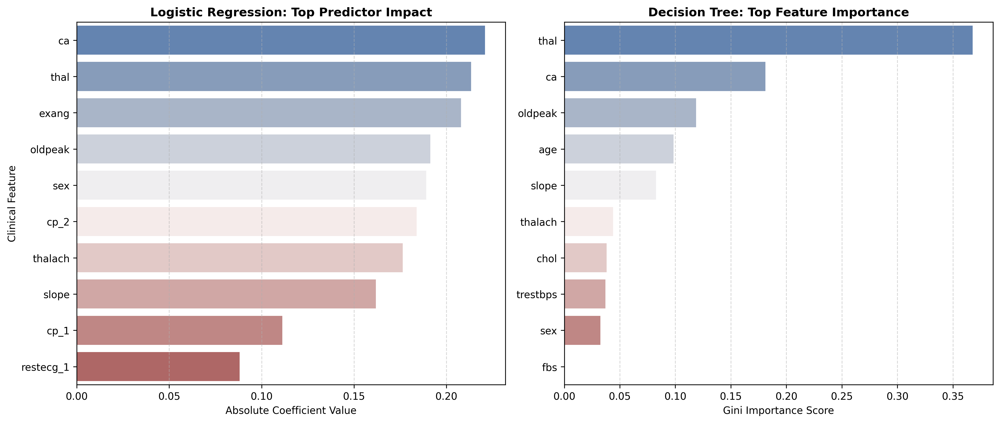

# Heart Disease Risk Classification

An end-to-end machine learning pipeline that predicts whether a patient is at high risk of heart disease from 13 routine clinical measurements. The project compares **Logistic Regression**, a **Decision Tree** and a **Random Forest** ensemble, with a focus on leakage-free preprocessing, interpretability and clinically meaningful evaluation.

Final project for the *Machine Learning* course (10123), Azrieli College of Engineering, Jerusalem.



## Results

Test set: 61 patients (20% hold-out). Precision, recall and F1 refer to the **high-risk class**.

| Model | Train Acc | Test Acc | Precision | Recall | F1 | 5-fold CV Acc (train) |
|---|:---:|:---:|:---:|:---:|:---:|:---:|
| Logistic Regression (C = 0.01) | 0.830 | 0.820 | 0.818 | **0.844** | 0.831 | 0.818 ± 0.056 |
| Decision Tree (max_depth = 4) | 0.880 | 0.787 | 0.852 | 0.719 | 0.780 | 0.764 ± 0.021 |
| **Random Forest (100 trees)** | 1.000 | **0.852** | **0.897** | 0.813 | **0.852** | **0.826 ± 0.049** |

**Key findings**

- **Random Forest** had the best test accuracy (85.2%) and the fewest false alarms (high-risk precision 89.7%).
- **Logistic Regression** had the highest sensitivity (84.4%, 5 missed high-risk patients vs. 6 for Random Forest). That matters in screening, where a missed patient costs more than a false alarm. It also stays interpretable and has the smallest train-test gap (~1%).
- The single **Decision Tree** overfit (~9% gap) and missed 9 of 32 high-risk patients.
- The strongest predictors across models were `ca` (number of major vessels), `thal`, `oldpeak` (ST depression) and `exang` (exercise-induced angina).

> **Limitations.** The dataset is small (302 unique patients), so a 3% difference in test accuracy is about 2 patients. Hyperparameters were selected with the hold-out set, so the cross-validation column is the more conservative estimate. By that measure, Logistic Regression and Random Forest perform about the same.

## Pipeline

1. **Data cleaning**: remove duplicate rows (1 found) and validate that labels are binary.
2. **Train/test split**: 80/20 with a fixed seed, done *before* any statistics are computed.
3. **Outlier handling**: physically impossible values (negatives) and IQR outliers in `age`, `trestbps`, `chol`, `thalach` are masked as missing.
4. **Imputation**: median for continuous features and mode for categorical ones, learned on the training set.
5. **Encoding**: one-hot encoding of the nominal features `cp` and `restecg` (`drop_first=True`).
6. **Scaling**: `StandardScaler` fitted on the training set only.
7. **Modeling**: hyperparameter curves for `C`, `max_depth` and `n_estimators`; evaluation with confusion matrices, precision/recall/F1 and feature importance.

Every transformation is learned from the training data and then applied to the test set, so no information leaks from the test set.

## Project Structure

```
├── classification_project.ipynb   # Full analysis: EDA, preprocessing, modeling, discussion
├── pipeline.py                    # Reproducible script version of the final pipeline
├── test_pipeline.py               # Unit tests (pytest)
├── heart.csv                      # Dataset
├── report.docx                    # Written report documenting design decisions (Hebrew)
├── plots/                         # Figures generated by the notebook
└── requirements.txt
```

## Getting Started

```bash
git clone https://github.com/<your-username>/heart-disease-classification.git
cd heart-disease-classification
pip install -r requirements.txt
```

Run the pipeline and print the model comparison:

```bash
python pipeline.py
```

Run the tests:

```bash
pytest -v
```

Explore the full analysis:

```bash
jupyter notebook classification_project.ipynb
```

## Dataset

The data is the widely used Kaggle version of the [UCI Cleveland Heart Disease dataset](https://archive.ics.uci.edu/dataset/45/heart+disease): 303 patients, 13 features, binary `target` (1 = high risk, 0 = low risk).

| Feature | Description |
|---|---|
| `age`, `sex` | Demographics |
| `cp` | Chest pain type (0–3) |
| `trestbps` | Resting blood pressure (mm Hg) |
| `chol` | Serum cholesterol (mg/dl) |
| `fbs` | Fasting blood sugar > 120 mg/dl |
| `restecg` | Resting ECG results (0–2) |
| `thalach` | Maximum heart rate achieved |
| `exang` | Exercise-induced angina |
| `oldpeak` | ST depression induced by exercise |
| `slope` | Slope of the peak exercise ST segment |
| `ca` | Number of major vessels colored by fluoroscopy (0–4) |
| `thal` | Thalassemia type |

*Note:* this Kaggle version has a few known quirks compared to the original UCI data, such as `ca = 4` and `thal = 0` values that were missing in the original. The project is an educational ML exercise and is not intended for clinical use.

## Tech Stack

Python · pandas · NumPy · scikit-learn · Matplotlib · Seaborn · Jupyter · pytest
